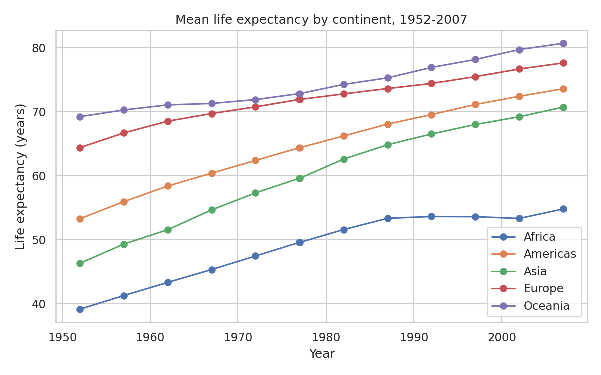
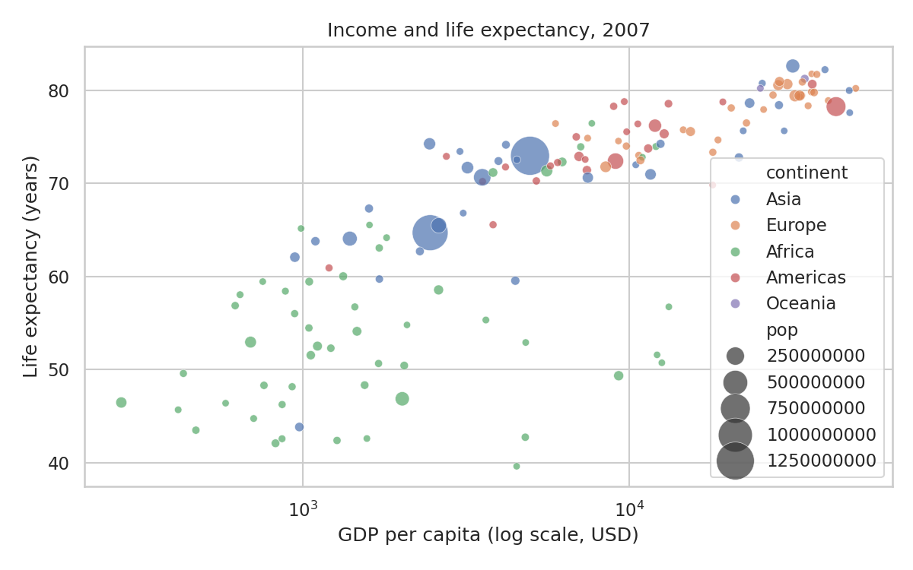
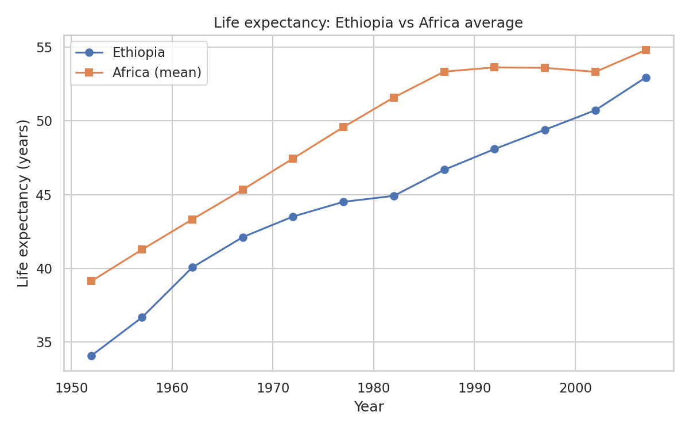

# Income and Life Expectancy, 1952–2007

Exploratory analysis of how national income relates to life expectancy across 142 countries over 55 years, with a focus on Africa and Ethiopia.

## 1. Questions
1. How much has life expectancy improved on each continent since 1952?
2. How strongly is income (GDP per capita) related to life expectancy?
3. Is the gap between Africa and the rest of the world closing?
4. Which countries live much longer, or shorter, than their income predicts?

## 2. Data
- **Source:** Gapminder, via the [plotly datasets repository](https://github.com/plotly/datasets) (`gapminder_unfiltered.csv`)
- **Raw size:** 3,313 rows × 6 columns (country, continent, year, lifeExp, pop, gdpPercap)
- **Cleaned panel:** 142 countries × 12 years (1952, 1957, …, 2007) = 1,704 rows
- Data dictionary: see below

| Column | Meaning |
|---|---|
| country | Country name |
| continent | Continent |
| year | Observation year (5-year steps) |
| lifeExp | Life expectancy at birth (years) |
| pop | Population |
| gdpPercap | GDP per capita (inflation-adjusted USD) |
| log_gdp | log10 of gdpPercap (added) |

## 3. Method
1. **Quality checks:** no missing values, no duplicate rows, no duplicate country-year pairs.
2. **Comparability fix:** the raw file mixes 5-year census points with sparse extra years, and many countries lack some years. I kept the 12 standard years and only countries observed in all of them, so trends compare the same countries over time.
3. **Transformation:** income is heavily skewed, so I used log10(GDP per capita).
4. **Analysis:** continent means, Pearson correlation, simple linear regression, and residual analysis.

**Model (2007 cross-section):**

LifeExp = α + β · log10(GDPpc) + ε

Residual: eᵢ = LifeExpᵢ − (α̂ + β̂ · log10(GDPpcᵢ))

## 4. Key findings

| Finding | Result |
|---|---|
| Africa mean life expectancy | 39.1 (1952) → 54.8 (2007), +15.7 years |
| Europe mean life expectancy | 64.4 (1952) → 77.6 (2007), +13.2 years |
| Asia mean life expectancy | 46.3 (1952) → 70.7 (2007), +24.4 years |
| Income vs life expectancy, 2007 | r = 0.81, R² = 0.65 |
| Regression slope | About 16.6 extra years for every 10× increase in income |
| Gap, rest of world minus Africa | 15.7 years (1952) → 19.3 years (2007) |
| Ethiopia | 34.1 (1952) → 52.9 (2007), +18.8 years, but still below the Africa mean of 54.8 |

**Takeaways**
- Every continent improved, but Africa's gap with the rest of the world **widened** after 1987, from 15.6 to 19.3 years by 2007.
- Income explains about 65% of the variation in life expectancy, so roughly 35% depends on other factors.
- **Over-performers:** Vietnam (+13.1 years above prediction), Nicaragua, West Bank and Gaza, Comoros. These countries live much longer than their income suggests.
- **Under-performers:** Swaziland (−25.9), Angola, Botswana, South Africa, Equatorial Guinea. Several are middle-income countries in southern Africa, a pattern consistent with the HIV/AIDS epidemic in that period (this dataset cannot test that explanation).

## 5. Visuals




## 6. Limitations
- Correlation is not causation; income and health influence each other.
- A single cross-section (2007) ignores differences within countries.
- Continent means are unweighted by population.
- Data ends in 2007.

## 7. Recommendations (illustrative)
- Programmes aiming to improve health should not rely on economic growth alone: Vietnam and Nicaragua show that low-income countries can achieve high life expectancy.
- Countries far below their predicted value, such as the southern African cases, warrant targeted health investigation.

## 8. How to run
```bash
git clone https://github.com/ismaeladan38-art/life-expectancy-analysis.git
cd life-expectancy-analysis
pip install -r requirements.txt
python scripts/analysis.py
```
Charts are saved to `images/` and the cleaned data to `data/gapminder_clean.csv`.

## 9. Repo structure
```
├── data/
│   ├── gapminder_raw.csv
│   └── gapminder_clean.csv
├── images/
├── scripts/analysis.py
├── requirements.txt
└── README.md
```

## Tools
Python (pandas, NumPy, Matplotlib, seaborn)
